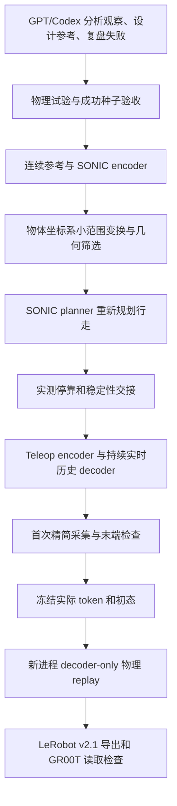

# SONIC：GPT 辅助抓取、成功 token 与单种子数据增广

从 GPT/Codex 辅助设计并经过物理验证的一条抓瓶参考，使用 SONIC encoder/decoder 生成新的走近抓取数据。默认使用已验证的精简采集：首次录训练 RGB 和动作，独立 replay 不录图像，导出复用视频。

本仓库保留原始目录和控制代码，补齐可迁移场景、模型、成功种子、依赖快照及统一启动入口。GPT 提出策略与参考，SONIC encoder 产生 token；GPT 不直接生成可信电机动作或 64 维 token。提供已成功的 `safe025` 种子，首次使用无需重新搜索抓取。

## 交给另一位使用者

**首次交付请提供完整离线包 `sonic-grasp-augmentation_20261008.tar.gz`。** 它包含源码、encoder/decoder/planner、原始运行所需权重、场景、贴图、双 Revo2 模型、成功种子和依赖源码。Git 只跟踪源码、文档与资源哈希；仅复制 Git 跟踪文件时，还需解压完整包补齐 `payload/`。启动时逐文件验证 `resources.json`，缺资源会明确报错。

要求 Linux x86_64、Python 3.11、NVIDIA RTX GPU 和兼容显卡驱动。已验证机器为 RTX 4090、Ubuntu 22.04、Isaac Sim 5.1.0、torch 2.7.0 CUDA12.8；没有在另一台干净机器安装测试。Isaac Sim 和 GPU 驱动不打包。安装方式遵循 [Isaac Sim 5.1 官方说明](https://docs.isaacsim.omniverse.nvidia.com/5.1.0/installation/install_python.html) 和 [Isaac Lab 官方 pip 安装说明](https://isaac-sim.github.io/IsaacLab/main/source/setup/installation/pip_installation.html)，固定使用 5.1 / Python3.11，不自动升级到新版本。

```bash
tar -xzf sonic-grasp-augmentation_20261008.tar.gz
cd sonic-grasp-augmentation

# 系统视频工具用于导出；imageio-ffmpeg wheel 不提供 PATH 中的 ffprobe。
sudo apt-get install ffmpeg

# 已有匹配的仿真环境可跳过安装；否则此脚本在本仓库创建 .venv。
bash setup_environment.sh
source .venv/bin/activate

python launch.py prepare
python launch.py doctor
python launch.py candidate --dx 0.005 --output ../sonic_runs/candidate_001
python launch.py collect --candidate ../sonic_runs/candidate_001 \
  --output ../sonic_runs/pair_001
python launch.py check-export --dataset ../sonic_runs/pair_001/lerobot_all_train
```

安装需要联网下载 Python/Isaac 依赖；模型和场景在离线包内，采集阶段无 GPT API 请求。Isaac 首次启动可能安装扩展并要求接受其许可。不要向仿真环境安装 standalone `usd-core` 覆盖 Isaac 的 USD。

所有命令支持 `--runtime /path/to/new_runtime` 和 `--ort-path /path/containing/onnxruntime`。默认从 `payload/` 物化到 `runtime/`；搬迁仓库后使用一个新的 runtime。继承的上游 motion loader 会替换全路径中的 `robot→meta`，因此 **runtime 和输出路径不能包含 `robot` 子串**。旧输出禁止覆盖；失败保留日志，重试使用新目录。

## 具体流程



1. **获得成功种子。** 按 [GPT 任务提示](gpt/TASK_PROMPT.md) 和历史提示词分析双手安装、接近、闭指、提起与持握。只改新候选，实际运行并保留失败证据。当前可复现的是已提供的同瓶同桌参考；任意新物体、新路点的成功没有保证。历史成功来自会话辅助迭代，后来的外部 GPT API 实验未获得新的成功抓取，未作为生产默认入口。
2. **编码参考。** `seed-reference` 复用原 `20260929_sonic_teleop_grasp/prepare.py`，把成功参考的双腕、躯干三点位姿和腿部未来参考输入 mode1 encoder，生成离线预览 token。在线执行会用实际根朝向/位置修正，因此预览 token 不一定等于实际下发 token。
3. **单轨迹扩展。** `candidate` 复用 `compile_candidate` 与 `compile_mobile`。在同一瓶子附近平移、绕瓶旋转、仅缩放非接触接近段；做双手 mesh-AABB 几何筛选。行走重新运行 SONIC planner，不能平移旧行走 token 冒充新规划。
4. **首次执行。** 同一个 release decoder 负责 29 身体关节，行走 mode0、抓取 mode1；decoder 的实时本体历史持续，手指各6维独立控制。物理200Hz、控制50Hz、相机原生25Hz。实测停靠位置、脚速和姿态通过门限才进入抓取，执行中不回填机器人/物体状态。
5. **精简采集与成功检查。** 只存训练必要的真实状态、RGB、实际 token、双手目标和索引；保留200Hz接触保护和末端持瓶检查。默认不采深度、分割、第三视角、完整身体/物体状态、逐子步PD日志或全部网络中间张量。
6. **独立 replay。** 冻结首次实际下发的 token、双手目标、初态与参数，在新仿真进程只跑 decoder 和实时本体历史，不重新执行 encoder/planner/IK，不录视频。仍执行完整物理序列，验收末端连续3秒持瓶及运行保护汇总。精简验收不检查整个轨迹逐帧相等。
7. **导出。** `lean_export.py` 直接复用首次已对齐 MP4，写 Parquet 和 LeRobot v2.1 元数据。默认全部 train；`check-export` 复用包内真实 GR00T episode loader，逐项检查实际 token、手目标、帧数和 RGB 尺寸。这不等于已经训练模型。

```bash
# 重新编码已有种子的 mode1 离线参考；只编码，不证明物理成功。
python launch.py seed-reference --output ../sonic_runs/reference_001

# 只做首次试验，供 GPT 分析；失败退出2并保留输出。
python launch.py trial --candidate ../sonic_runs/candidate_001 \
  --output ../sonic_runs/trial_001
# 对成功首次执行冻结其实际token，再独立回放。
python launch.py replay --first ../sonic_runs/trial_001 \
  --output ../sonic_runs/replay_001
```

**可跳过独立 replay 以提速：使用上面的 `trial` 命令只做首次生成和RGB采集，不运行后续 `replay`。** 最新完整配对5分48秒包含首次生成3分6秒＋replay2分42秒；只采集首次轨迹按该 generate 进程实测约需3分钟，准备/GPT/候选编码另计。`trial` 不自动导出 LeRobot；`collect` 和批量collect仍默认逐条复验，目前没有 `--no-replay` 参数，`--no-export` 也不会关闭 replay。跳过后须保留“未回放”状态，不能把首次成功写成独立回放成功。详见 [运行方式与验证边界](docs/RENDERING.md#跳过独立-replay-以提速)。

`--seed /path/to/validated_grasp` 可替换抓取种子。目录必须匹配原始契约：`grasp_reference.npz`、`grasp_tokens.npz`、`initial_state.npz`、`deployment_parameters.json`、`waypoints.json`；原 mode1 参考编译还读取 `geometry_check.json`。修改种子后必须重新检查几何与物理，不能沿用旧成功结论。走近/停靠当前仍使用这一桌边的既有校准，换场景需要重新验证。

## 一条种子准备并采集60条

```bash
# 默认原50个瓶子位置与10个额外起点，不先采50条站立中间轨迹。
python launch.py prepare-batch --count 60 --output ../sonic_runs/batch_001
python launch.py collect --candidates ../sonic_runs/batch_001/candidates \
  --output ../sonic_runs/collected_001
python launch.py check-export --dataset ../sonic_runs/collected_001/lerobot_all_train
```

候选准备复用原 `batch.schedule` 和 `collect.mobile_schedule`；正式执行改用原 `lean_batch.py`，逐条首次执行和独立 replay，最后统一导出。`--count 2`、采集 `--limit 2` 可用于小批启动。几何筛选或物理失败会停止，保留证据；60只是目标数量，不能保证任意种子60/60成功。批次支持跳过已成功的 pair；遇到未完成/失败目录须先诊断，已存在最终导出目录禁止覆盖。

批次输出记录候选来源目录、候选文件清单哈希和资源版本及渲染更新次数；续跑必须使用同一批候选。修改候选或换种子后使用新的输出目录，避免按同名错误复用旧结果。runtime 复用时也验证物化文件哈希。

默认逐条 replay。历史最后10条用过“固定随机10%＋边界/修正样本”抽检，实际抽检5/10；相应原 `finish_remaining.py` 保留用于追溯，但依赖历史50条目录，不作为新仓库的一键入口。未回放样本必须保留 `not_sampled`，不能标成回放成功。

## 大概用时与计时边界

首次搜索新抓取的 GPT 分析、人工检查、失败重试耗时没有可靠总统计；不包含在下面单条已知种子的采集中。环境安装/下载、首次编译扩展和资源解包也另计。

参考重新编码本机约1.14s；2条候选准备进程共30.90s。完整60条候选的编码与几何准备区间约718s（12分钟，依据文件时戳），已检查60份候选清单、840个文件哈希及各候选的桌面几何筛选结果。这一准备步骤另计，不包含在“6分钟一条”中。启动准备批次的计时进程受工具服务重启中断，故60条没有完整进程墙钟记录；见 [准备证据](evidence/batch_preparation_20261008.json)。

后续单条步骤中，首次生成执行约3–4.5分钟，无相机replay执行约2.4–2.8分钟；本次两个进程启动/收尾等额外区间分别约25s、23s。导出直接复用MP4，本次配对的其余开销不足1s，未单独分离导出计时；GR00T逐帧读取检查另计。不同机器、资源竞争和首次加载会改变这些数字。

|测量|首次生成|独立replay|合计/说明|
|---|---:|---:|---|
|旧50条平均，含准备/启动/收尾/审计/重压缩|437.6s|355.3s|792.9s，13.2分钟；中位数11.7分钟|
|10月1日精简配对，执行/采集区间|211.45s|163.77s|375.22s，6分15秒；不含完整启动退出/导出|
|新增10条精简首次采集|中位197.78s|—|范围180.59–238.29s，执行/采集区间|
|10月7日固定token性能复测，无相机n=3|—|执行146.83±2.26s|进程总162.26–170.62s|
|10月7日固定token性能复测，有相机n=3|—|执行173.08±1.56s|进程总188.80–191.66s；仅回放性能对照|
|10月8日本仓库迁移后完整配对|执行272.81s；进程298.04s|执行166.83s；进程190.02s|含导出488.43s，8分8秒；生成前段观测到其他GPU任务|
|10月8日RT2/DLAA默认1次更新，完整配对n=1|执行161.86s；进程186.02s|执行140.81s；进程162.02s|含导出348.37s，5分48秒；准备/编码另计，视觉时序验收未完成|

10月7日数据使用匹配的新驱动，不能把跨日期差值全部归因于代码加速。有相机固定 token 回放不运行 encoder/planner，不能用它替代首次生成时间。旧版详细分桶见 [50条计时](evidence/old50_timing.json)，精简实测见 [配对实验](evidence/lean_pair_benchmark.json)，最新组件证据见 [10月7日报告](evidence/20261007_REPORT.md)。

10月7日无相机组件测速中：物理接口55.9s、接触刷新/力读取39.9s、其他场景更新18.1s、观测14.2s、控制7.3s、decoder1.2s，其余约10.3s。物理/接触/场景/观测约占87.2%，decoder约0.83%。这是互斥墙钟分桶，包含同步等待，不是纯GPU核函数时间。进一步提速需要测量这些组件，不能凭推理时间猜测；本次整合未减少物理步或接触覆盖。

`collect` 输出 `launcher_timing.json`，记录包含启动/退出/导出的子进程完整耗时；pair的 `status.json` 分别保存 `first_wall_s`、`replay_wall_s`，各运行 `lean_result.json` 保存 `elapsed_capture_s`。资源准备另计。并发GPU任务可能明显拖慢，不能承诺每条完整流程恰好6分钟。

目前已去掉replay相机、冗余观测/中间日志和导出重压缩。若还要简化，可按最新组件计时继续优化场景与观测更新，或明确将独立replay改为有标记的抽检以省去部分复验；后者降低每条数据的验证覆盖。本仓库默认仍逐条复验，不修改原控制逻辑。

## 数据与能力边界

- 已验证技能是同桌、同瓶、同尺寸G1与双Revo2的右手走近抓瓶。历史60条、64240帧全部首次成功，其中55条经过独立replay，5条未抽检；这些是历史证据，不是本次新生成60条。
- 历史增广范围：瓶子水平x±1.5cm、y±1cm的10×5网格；抓取偏航±1.5°；非接触接近比例0.995–1.005。额外起点横向±2cm、纵向至±2.5cm、朝向±2°。单候选函数允许的更大参数范围是实验输入上限，不是已验证成功范围。
- 机器人几何、瓶子尺寸/质量、摩擦、控制增益和手安装不变；瓶质量/摩擦仍是仿真假设。几何筛选仅双手mesh-AABB，未覆盖全身、房间或实际decoder跟踪误差；物理监测也不等于全环境碰撞认证。
- 末端持瓶≥3s、末3s对向接触≥95%、相对滑移≤15mm、旋转≤10°、监测桌面接触峰值≤0.05N。停靠门限5cm，不因采集失败自动放宽。
- 状态41维：29身体关节＋双手6+6；重力另3维。动作为64维SONIC浮点latent＋双手6+6，共76维；不是整数词表ID或另一种手的78维配置。
- 原生RGB640×480、25Hz，因果保持到50Hz视频/动作；保存索引和图像年龄，不能用任意MP4帧号配对动作。历史视频使用旧RTX realtime/DLAA；当前新采集默认RT2原生DLAA，每状态1次更新，详见docs/RENDERING.md。
- 从实际关节状态事后重新编码，不是原控制器的无损逆映射；历史重编码回放曾在抓取前停靠失败。训练/回放使用首次**实际下发**token。
- 不支持任意新物体、新手模型、跨桌高、房间导航避障、持物行走或真机可靠性保证。更换场景/种子须重新校准、执行和验收。
- 全视频可解码和物理成功不等于完整时序视觉验收。输出保持 `training_ready=false`、视觉复核pending；未把闪烁、缺指、穿透等问题自动认证。

## 源码复用与验证

`payload/workspace/pipelines/sonic_teleop_augmentation/` 是原始生产/lean源码；`payload/workspace/experiments/` 保留种子编译、执行和审计源码；`payload/vendor/SONIC/`、`dependencies/` 保留依赖快照。源码中的 `__RUNTIME__` 仅在启动时替换，不直接运行模板文件。

新增逻辑集中在 `launch.py`、`prepare_batch.py` 和环境/打包脚本。沿用场景包已有的路径、资产flatten和无需原Git的溯源适配；补充种子路径配置、参考输出目录参数和显式GR00T路径。源文件、模型和初态哈希见 `source_manifest.json` / `resources.json`，修改分类见 `docs/SOURCE_CHANGES.json`。

```bash
python -m unittest discover -s tests -v
python pack.py --output ../exports/sonic-grasp-augmentation_20261008.tar.gz
```

本机独立路径的迁移验证结果见 [VALIDATION.md](docs/VALIDATION.md)。模型、依赖源码与资产遵循各自许可，见 [NOTICE.md](NOTICE.md) 和 `licenses/`；本仓库不包含API凭据或GPU驱动。

## 渲染配置与对比

当前RT2原生DLAA默认普通状态1次更新，支持2/4次对照；首次采集预热单独处理。参数、历史A/B/C/D与最新D4/D2/D1计时、画质边界和运行命令见 [渲染说明](docs/RENDERING.md)，[四路历史视频](media/rendering_comparisons/abcd_20260921.mp4)已作为用户授权的样例纳入Git。保持视觉未验收标签；Git源码之外仍需对应场景/模型资源。
